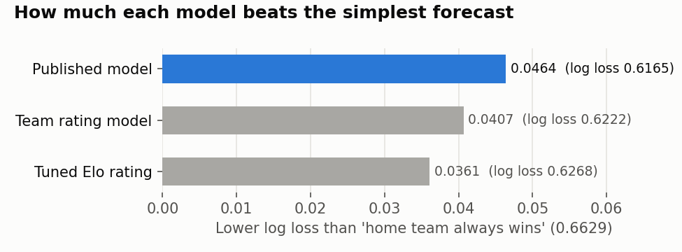
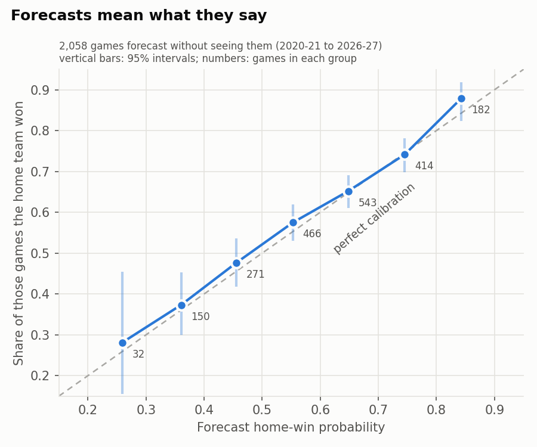
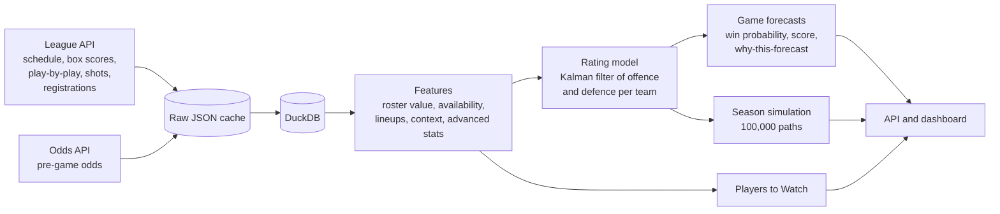

# EuroLeague Outcome Projection

[](../../actions/workflows/tests.yml)


A fan-built forecasting system for the Turkish Airlines EuroLeague. Before every round it gives:

- a **win probability and an expected score** for every game,
- each team's chances of the **play-in, playoffs, Final Four and title**, from 100,000 simulated seasons,
- **Players to Watch**: who is expected to produce most and who is set to beat his own norm,
- and **why** each forecast is what it is, part by part.

Every number can be traced back to stored data and a recorded model run, and every claim about accuracy below was measured on games the model had not seen.

> This is an independent fan project. It is not affiliated with or endorsed by Euroleague Basketball. It gives no betting advice.



## How good is it?

Measured walk-forward on **2,058 games (2020-21 to round 4 of 2026-27)**: every season is forecast with settings fitted only on earlier seasons, and every game only with what was known before tip-off.

| Model | Winners picked | Log loss (lower is better) |
|---|---|---|
| Home team always wins | 62.3% | 0.6629 |
| Tuned Elo rating | 65.1% | 0.6268 |
| Team rating model alone | 65.3% | 0.6222 |
| **elsim (published model)** | **65.5%** | **0.6165** |

The published model beats a tuned Elo in all seven seasons (difference -0.0104 in log loss, 90% interval -0.0155 to -0.0055, resampling whole rounds).

**Its probabilities mean what they say.** Of the games it gave the home team about 75%, the home team won 74%; at about 85%, 88%.



**It is most useful when it is confident.**

| Favourite given at least | Share of games | Favourite won | Model expected |
|---|---|---|---|
| 60% | 64% | 71.0% | 70.7% |
| 65% | 45% | 76.0% | 74.1% |
| 70% | 31% | 78.0% | 77.3% |
| 75% | 18% | 84.6% | 80.8% |
| 80% | 9% | 87.6% | 84.3% |

**Expected scores** (same 2,058 games): each team's points are off by 8.0 to 8.2 on average, the total by 13.2 and the margin by 9.2, against 8.8 to 8.9, 14.5 and 9.9 for simply forecasting the usual score. The stated 80% range held the real margin in 82% of games and the total in 77% (pace is taken as known, so total ranges run slightly narrow).

**Season simulation.** Simulating the rest of five past seasons from rounds 5, 15 and 25, the chance of a top-eight finish scored a Brier of 0.091 to 0.164 against 0.246 with no skill, and real win totals fell inside the 80% range 85-89% of the time (measured with an earlier version of the game model).

### What to expect from it

The model knows how often it should be right: the average of its own winning-side probabilities. Season by season, that expectation matched what happened in six of seven seasons (the exception, 2023-24, was a season where favourites won unusually often):

| Season | Winners picked | Model expected | 90% range |
|---|---|---|---|
| 2020-21 | 64.9% | 65.2% | 61.0-69.5% |
| 2021-22 | 65.6% | 65.4% | 60.9-69.9% |
| 2022-23 | 64.0% | 65.2% | 61.0-69.2% |
| 2023-24 | 71.3% | 65.7% | 61.6-69.8% |
| 2024-25 | 63.9% | 64.8% | 60.6-69.1% |
| 2025-26 | 63.9% | 64.2% | 60.2-68.2% |

For the rest of the 2026-27 regular season (340 games, forecasts of 12 October 2026, 100,000 simulated outcomes) the expectation is **64.4%**, with a 90% range of 60.3-68.5%. A single round of ten games is far noisier: in past seasons the model picked 80% or more in 14% of rounds and 50% or fewer in 17%.

### Second competition: the EuroCup

To check that the method is not tuned to one league, the same code was run unchanged on the EuroCup (same league API, settings in `config/settings_eurocup.toml`): seasons 2020-21 to 2022-23 only train, and 2023-24 to round 3 of 2026-27 (616 games) are forecast walk-forward. Elo was tuned the same way on EuroCup data.

| Model | Winners picked | Log loss |
|---|---|---|
| Home team always wins | 58.0% | 0.6823 |
| Tuned Elo rating | 66.9% | 0.6183 |
| Team rating model alone | 65.6% | 0.6141 |
| **elsim** | **67.0%** | **0.6137** |

The model carries over: it beats Elo in three of four seasons (-0.0045 in log loss, better in 79% of round resamples) and its probabilities stay close to calibrated (favourites given 65% or more won 76.5% of the time against 75.1% expected). Expected scores were off by 8.8 to 9.1 points per team, against 9.9 for the usual score. The roster layers add nothing here (0.6137 against 0.6141 for the ratings alone): EuroCup rosters turn over more and many players have little EuroLeague-API history to value them by. Five of 1,149 played games could not be downloaded and are left out; injuries are not entered and arena coordinates are missing, so travel counts as zero.

### How that compares

| Who | Winners picked | How it was measured |
|---|---|---|
| **elsim** | **65.5%** (single seasons 62.5-72.5%) | 7 seasons, 2,058 games, walk-forward |
| Lampis et al. (2023), machine learning | 66-69% | one season, 2017-18 |
| Giasemidis (2020), machine learning | 66.0% | one season, 2018-19 |
| Fans' majority vote, same study | 73.2% | the same single season |
| Eurohoops / Clutch Data projection (2026) | 67.7% | "on historical data", method not given |

Single seasons differ a lot: in the 2018-19 season above, "last year's Final Four teams win" alone picked 72%. A figure from one season says little; seven seasons say more.

### The ceiling

Even a model that knew every team's true strength would pick only about **67-70%** of winners: one game's margin varies by about 18 points per 100 possessions, while true differences between teams vary by only 8-10. Ratings fitted on every other game of the same season, future games included, pick 65.0%. Claims of 75% or more over all EuroLeague games should be read with care; that level is reached only on the confident subset above.

The real test is the betting market. Opening and closing odds are collected every round, and the pass marks were written down before the games were played: [docs/FORWARD_TEST.md](docs/FORWARD_TEST.md).

## How it works



- **Team strength.** Each team's offence and defence (points per 100 possessions) are tracked game by game with a Kalman filter, with a league-wide home edge and correlated scoring between the two teams.
- **Rosters.** Each team is valued at every tip-off from the players registered and available then. A player's value combines a box-score value learned from lineup data (true shooting, assists, steals and rebounds weigh most) and a lineup-based plus-minus in which head coaches are credited separately. Signings, departures and injuries move the team when they happen.
- **Availability.** A player who missed his team's last three games is counted out; known injuries from the league's report are entered by hand and shown as a second forecast.
- **Context.** Rest days, travel distance, home and away form and a shot-zone matchup are weighed at half their fitted weight.
- **Season.** The rest of the season is played out 100,000 times with the league's real tie-break, play-in, playoff and Final Four rules.
- **Players to Watch.** Learned weights on a player's level, minutes and scoring form, and the opponent's record against his position.

Every addition had to pass a written rule before it was kept: lower log loss in at least 85% of resamples of whole rounds, no harm to the first ten rounds, and a gain above what a random feature would show. More than twenty ideas were measured; the ones that failed (team-specific home edge, coach win records, referees, in-season player updates, an Elo blend and others) are listed with their numbers in [docs/TECHNICAL_NOTES.md](docs/TECHNICAL_NOTES.md).

## Quick start

Requires Python 3.10 or later.

```bash
python -m venv .venv
.venv\Scripts\Activate.ps1        # Windows PowerShell; on macOS/Linux: source .venv/bin/activate
pip install -e ".[dev]"
copy .env.example .env            # then put your free The Odds API key in .env (optional)

elsim fetch-all                    # download and cache every season (first run takes a while)
elsim fetch-people
elsim load                         # build the database
elsim predict                      # forecasts for the coming rounds
elsim simulate                     # season probabilities
streamlit run dashboard/app.py     # dashboard in the browser
```

`python -m elsim.cli <command>` works the same as `elsim <command>`.

### Every round

| When | Command |
|---|---|
| The day before a round | `elsim round --odds --publish`: fetch, load, score the last round, forecast, simulate, opening odds, then commit and push the matchweek's forecasts |
| Each match day, within the hour before the first tip-off | `elsim snapshot-odds` (closing odds); `elsim odds-plan` prints the times |
| Before a round | update `config/absences.csv` from the league's injury report |

### All commands

| Command | What it does |
|---|---|
| `fetch-all`, `fetch-season`, `fetch-schedule`, `fetch-games`, `fetch-people` | Download and cache league data |
| `snapshot-odds`, `odds-plan` | Pre-game odds snapshot (one credit) and when to take them |
| `load` | Build the DuckDB database from the cache |
| `predict`, `simulate`, `round` | Forecasts (also written game by game: the matchweek to `forecasts/<season>/round-NN/games.txt` and `players.txt`, every remaining game to `predictions/<run>/`), season simulation, or the whole cycle |
| `publish` | Commit and push the latest matchweek's forecast files ("Matchweek update: rounds 5 and 6") |
| `track-record` | Our forecasts against the market on finished games, with closing-line value |
| `backtest` | Walk-forward evaluation: log loss, Elo comparison, calibration, scores |
| `backtest-players`, `backtest-simulator`, `backtest-absences` | The other evaluations |

The API (`uvicorn elsim.api.app:app`) serves `/run`, `/games`, `/explanations`, `/players`, `/simulation`, `/track-record` and `/zones`, each as `{"run_id": ..., "data": ...}`.

## Published forecasts

Every matchweek's forecasts are committed to [`forecasts/`](forecasts/), one folder per round or double round: `games.txt` (win chances, expected score and 80% ranges for each game) and `players.txt` (each team's expected top performers). They are written before tip-off, so the folder doubles as a public, timestamped track record.

## Project layout

```
src/elsim/
  ingest/      downloading, caching and parsing (league API, odds)
  derive/      lineups and possessions from play-by-play
  features/    team, player, roster, lineup, box-score, context and advanced statistics
  models/      rating model, backtests, forecasts, explanations, Elo, comparisons
  simulate/    season simulation and its backtest
  players/     Players to Watch and absences
  api/         FastAPI app and the shared queries
dashboard/     Streamlit dashboard
config/        settings, league format, venues, absences, team aliases
docs/          technical notes, plan, forward test, figures
tests/         51 tests; those that need real league data run only where tests/fixtures exists (it is not in the repository)
forecasts/     the published matchweek forecasts
```

## Data and limits

- **Sources.** The EuroLeague's public API (schedule, box scores, play-by-play, shot locations, registered players and coaches) and The Odds API's free tier for pre-game odds. Requests are rate-limited and every response is cached, so nothing is fetched twice. Injury information is entered by hand from the league's report and news sites. The data belongs to its owners; this repository holds only code, settings and the published forecasts. Downloaded data and the database stay on the machine that runs the system (`data/` and `tests/fixtures/` are not committed).
- **What the model cannot see.** Late lineup news, minutes restrictions, domestic-league fatigue (domestic schedules are not in the data) and anything that happens on the day.
- **Early season.** Forecasts in the first rounds lean on rosters and last season and are the least certain.
- **Not betting advice.** Market prices are shown for comparison only.

## Documentation

- [docs/TECHNICAL_NOTES.md](docs/TECHNICAL_NOTES.md): every measurement, decision and rejected idea, with numbers
- [docs/FORWARD_TEST.md](docs/FORWARD_TEST.md): the forward test against the market and the rule for changing the model
- [docs/PLAN.md](docs/PLAN.md): the original plan and its changes

## License

Code under the [MIT License](LICENSE). EuroLeague data, names and marks belong to their owners.
